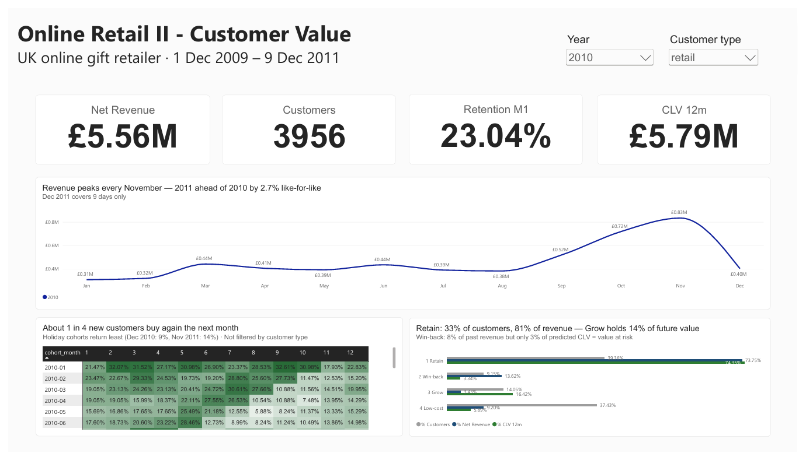

# Customer Value & Retention Analytics — Online Retail II

> **Business question:** Which customers will create the most value next year, which are slipping away, and where should a limited marketing budget go?

UK online gift retailer · 1.07M transaction lines · Dec 2009 – Dec 2011 · **SQL (DuckDB) → Python (CLV, basket) → Power BI**



---

## TL;DR

| # | Finding | Evidence |
|---|---|---|
| 1 | **Revenue is concentrated**: top 20% of customers generate ~77% of net revenue; the *Retain* group (33% of customers) holds **81%** of revenue and **78%** of predicted 12-month CLV | RFM + CLV, Power BI |
| 2 | **Retention is the weak point**: only **23%** of new customers buy again the next month; holiday cohorts retain worst (Dec 2010: **9%**) | Cohort analysis |
| 3 | **Growth is seasonal, not structural**: November peaks every year; Nov 2011 grew +2.3% YoY *because cancellations fell*, not because orders grew | Metric decomposition |
| 4 | **CLV model beats the naive baseline** on a 6-month holdout (bias −0.7% vs +5.1%); predicted next-12-month CLV is £8.14M vs £8.00M actual last 12 months (+1.8%) | MBG/NBD + Gamma-Gamma |
| 5 | **Customers buy by theme/collection** (Retrospot, Polkadot, Vintage Christmas), not by product type | FP-Growth basket rules |

## Recommendations

| Action group (within retail / wholesale) | Customers | Net revenue | CLV 12m | Action |
|---|---|---|---|---|
| **1 Retain** — high value, active | 33.1% | 81.2% | 78.2% | Loyalty perks, early access — **no blanket discounts** (a 10% discount would give away ~7.9% of retail revenue for purchases that happen anyway) |
| **2 Win-back** — high value, lapsing | 6.9% | 7.7% | 3.1% | Time-limited offer, ranked by CLV. Retail is profitable only if campaign uplift ≥ **~4.2%** (wholesale ≥ ~0.8%) → **pilot with a 10% holdout first** |
| **3 Grow** — low value, active | 26.8% | 5.9% | **13.8%** | 2nd-purchase incentive + "complete your collection" emails based on basket rules |
| **4 Low-cost** — low value, lapsing | 33.2% | 5.2% | 4.8% | Automated email only; suppress non-openers |

Merchandising: add **"Shop the collection"** navigation (theme → colour → product type) alongside the product-type menu.

---

## Data Issues Found

The raw file is not analysis-ready. Each issue was profiled in SQL (`sql/01_quality_checks/`) and logged with a decision.

| Issue | Size | Decision |
|---|---|---|
| **The two Excel sheets overlap** (2010-12-01 → 12-09) | 22,523 rows / 1,088 invoices | Keep one copy |
| Exact duplicate rows | 11,812 rows (1.1%) | Remove |
| Cancellations (`C` invoices) | 19,494 rows | **Net against sales**, don't delete |
| Non-product codes (postage, fees, manual, test) | 4,792 rows, +£852K | Exclude via explicit denylist (regex flagged real products) |
| Bad-debt adjustments, inventory write-offs, zero-price lines | 6 / 3,457 / 2,745 rows | Exclude from sales |
| Dates stored as Excel serial numbers | all rows | `excel_to_ts()` macro |
| Missing Customer ID | ~¼ of lines | Keep for revenue, exclude from customer models |
| Ordered-then-cancelled data-entry errors (e.g. 80,995 units) | top CLV customer was one | Removed matched sale/cancel pairs **at the SQL source** (`NOT EXISTS`) |
| Partial last month (Dec 2011 = 9 days) | — | Annotated; like-for-like comparisons |

## Approach

```
online_retail_II.xlsx
   └─ sql/00_ingest        read_xlsx (all_varchar) → raw_transactions
   └─ sql/01_quality_checks one file per issue → decision log
   └─ sql/02_staging       dedupe, cast, row_type classification → stg_transactions
   └─ sql/03_analysis      trend, Pareto, cohort, basket profile
   └─ sql/04_marts         fct_sales, customer base, RFM, action groups → Parquet
        ├─ notebooks/03_clv.ipynb     BG/NBD vs Modified BG/NBD + Gamma-Gamma (pymc-marketing)
        ├─ notebooks/04_basket.ipynb  FP-Growth association rules (mlxtend)
        └─ dashboard/online_retail.pbix   star schema + 15 DAX measures
```

**Design rule:** SQL and Python are strictly separated — all querying/cleaning happens in `.sql`; Python only reads Parquet exported by SQL.

| Layer | Tool | Why |
|---|---|---|
| Storage / query | DuckDB | Local OLAP, reads Excel/Parquet directly, zero setup |
| SQL IDE | DBeaver | Same workflow as Postgres/Snowflake |
| Models | pymc-marketing, mlxtend | Probabilistic CLV, association rules |
| BI | Power BI | Star schema (fact + customer/date dims), explicit DAX measures |

### Method notes
- **Wholesale vs retail:** customers with ≥ 500 avg units/order (6.4% of customers, 31.5% of revenue) are scored separately so wholesale doesn't dominate every ranking.
- **RFM:** Recency & Monetary by quintile; Frequency by fixed bins (quintiles break on ties).
- **CLV validation:** calibration/holdout split at 2011-06-09. BG/NBD forces P(alive)=1 for one-time buyers → switched to Modified BG/NBD (same accuracy, sensible P(alive)).
- **Action matrix uses historical value × recency**, not CLV × P(alive) — CLV already contains P(alive) (double counting), and P(alive) barely penalises one-time buyers (dormant 424 days → 0.81).
- **Basket rules** kept only lift > 1, confidence ≥ 0.3, support ≥ 1%; rule type (variant vs cross-sell) classified from product names (no category master available).

## Limitations
- CLV total runs 1.8% above the last 12 months' actuals → use for **ranking**, not revenue forecasting; the model is stationary (no seasonality).
- Win-back economics rest on assumed uplift, margin (30%) and cost (£5/customer) — scenario, not forecast.
- Cohort matrix and Retention M1 in the dashboard are not filtered by customer type.
- Wholesale basket rules rest on ~36 invoices each; correlation ≠ causation.
- Single UK retailer, 2009–2011.

## How to Reproduce

```powershell
winget install DuckDB.cli
winget install --id DBeaver.DBeaver.Community -e
winget install astral-sh.uv
uv sync
```
1. Download `online_retail_II.xlsx` from [UCI](https://archive.ics.uci.edu/dataset/502/online+retail+ii) (CC BY 4.0) into `data/raw/`.
2. SQL scripts use absolute paths (`E:/Data_Analytic/Online Retail II/...`) — replace with your clone path.
3. Run `sql/00_ingest` → `02_staging` → `04_marts` in file order (see [`sql/README.md`](sql/README.md)).
4. `uv run jupyter lab` → run `notebooks/03_clv.ipynb`, then `sql/04_marts/06–07`, then `notebooks/04_basket.ipynb`.
5. Open `dashboard/online_retail.pbix` (repoint the Parquet sources to your path).

## Project Structure
```
├── data/            raw/ + marts/ (gitignored — regenerate with the steps above)
├── sql/             00_ingest · 01_quality_checks · 02_staging · 03_analysis · 04_marts
├── notebooks/       03_clv · 04_basket
├── dashboard/       Power BI file + spec
└── reports/         basket rules · dashboard image
```

## Citation
Chen, D. (2012). Online Retail II [Dataset]. UCI Machine Learning Repository. https://doi.org/10.24432/C5CG6D
